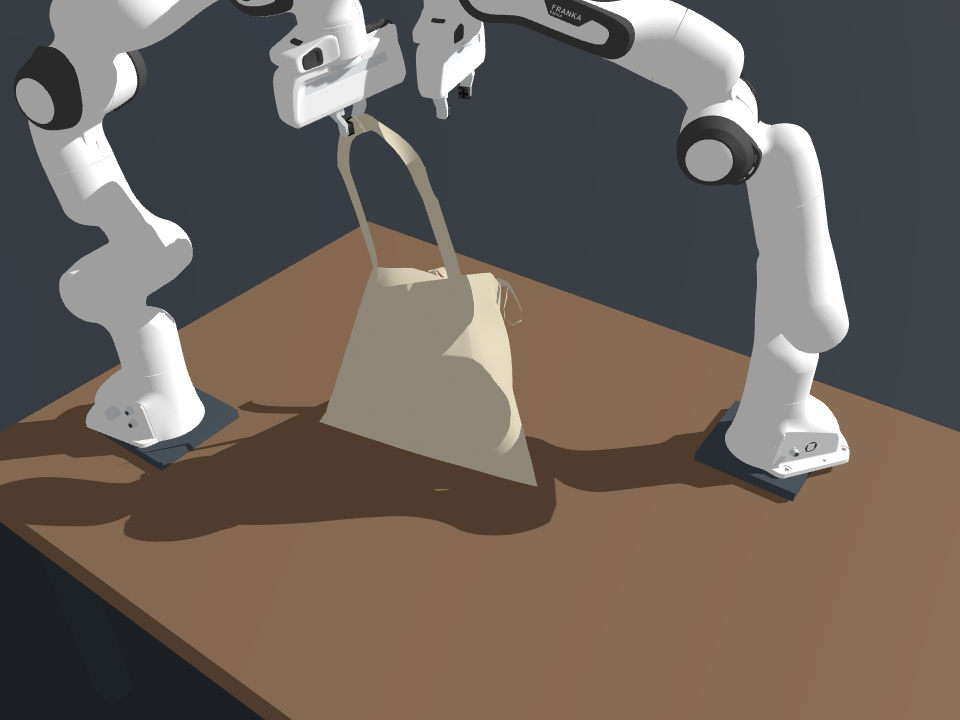

# 双 Franka：软体熊装入两片缝合布袋

基于 Genesis 与原生 IPC 接触的桌面仿真：双臂撑开布袋，左臂持续握住一根提带，右臂抓起软体熊、放入袋中、松爪并撤离。

布袋由两片布沿左右和底边直接缝合，上口开放，**没有立体底宽、侧片或刚体袋壳**。当前默认为 full40：保持已确认的熊尺寸和动作流程，仅调整布袋材料。



[观看完整仿真视频](teddy_bag_scene/runs/two_panel_full_40/simulation.mp4) · [下载完整项目与原始记录](https://github.com/Chloe-Jinlei/genesis-dual-franka-teddy-bag/releases/tag/v1.0.0-full40)

## 仓库包含什么

- `teddy_bag_scene/`：场景源码、连续动作控制、原生物理适配、全部模型与布料资产、当前及历史配置、分析工具和保留的运行报告。
- `teddy_bag_scene/runs/two_panel_full_40/`：最新完整仿真的视频、阶段图、冻结输入和验证报告。大体积原始数组见 Release 的 `full40-complete-evidence.tar.gz`。
- `environment/`：完整 Python 版本锁定、原生库兼容信息、Genesis 版本和下载校验值。
- `scripts/`：下载、恢复依赖与环境检查；根目录 `run.sh` 是可移植启动入口。
- Release：**全部原始场景文件和所有历史运行**的分卷归档，另提供完整 full40 数据、原生依赖和固定版本 Genesis 源码。只排除了生成缓存、Python 字节码和安装锁文件。

大型轨迹保存在 Release，避免普通 Git 的单文件限制。[GitHub 文件限制](https://docs.github.com/en/repositories/working-with-files/managing-large-files/about-large-files-on-github)。分卷、独立附件及每个原始文件均有 SHA-256 清单。

## 运行环境与安装

已验证原环境：Linux x86-64、CPython 3.12、Genesis 1.4.3（`ffd119c30118ebb9745fc009349efb2112a8cb76`）、pyuipc 0.0.29、PyTorch 2.14.0+cu130；RTX 5070 Laptop 8 GB，驱动 595.99.02。原生 wheel 要求 glibc ≥2.34。窗口模式需要 GLX/X display，无窗口模式仍需要可用的 EGL/OpenGL 与 NVIDIA 驱动。

安装 [uv](https://docs.astral.sh/uv/getting-started/installation/) 后：

```bash
git clone https://github.com/Chloe-Jinlei/genesis-dual-franka-teddy-bag.git
cd genesis-dual-franka-teddy-bag
bash scripts/setup_environment.sh
./run.sh --headless --task full --output my_full_run
```

`my_full_run`必须是尚不存在的输出名称。窗口模式将`--headless`换成`--viewer`。`--task handoff`只执行撑袋与单手持袋交接。

安装脚本下载并校验源码/原生依赖，在仓库内创建`.venv`，从固定版本锁恢复依赖，并明确安装官方 cu130 Torch 构建。它不会修改系统 Python。环境较大，需要网络和足够磁盘空间。精确环境记录见 [environment](environment/)。

**验证范围：**原本机完整任务已通过；上传副本仅将活动 Franka XML 的资源路径相对化，并带上67个原始网格，模型数值与网格字节内容的554项核对通过。另验证了导出环境导入和模型加载。没有声称已经在另一台干净机器上完成安装或完整重跑。

## 当前结果与材料

原验收 [20/20](teddy_bag_scene/runs/two_panel_full_40/validation.json) 与独立核对 [41/41](teddy_bag_scene/runs/two_panel_full_40/independent-gravity-execution-review.json) 均通过。实际仿真86.760秒，完整视频约87秒，本机计算约57分钟。松爪前与最终的全部1450个熊节点及其质心在分析袋身内部，撤手后自然稳定4秒。

| 项目 | 当前值 |
| --- | --- |
| 熊初始尺寸 | 15.94 × 21.28 × 6.69 cm |
| 袋身两片布 | 每片46 × 40 cm，直接U形缝合 |
| 袋子膜内抗拉输入 E | 10 MPa |
| 独立弯曲刚度 | 10 µN·m |
| 对应布料面密度 | 200 g/m² |
| 袋身／提带有效剪切系数 | 50／350 N/m |
| 袋重／熊重 | 约80.05／63.78 g |

相对调整前，持袋提带的局部构造长轴伸长峰由4.78%降至2.35%，最大主伸长由8.57%降至4.62%。后袋片个别斜向热点增加，不能说所有区域都改善。材料仍有局部伸长，未对真实棉麻样布的回弹或迟滞做标定。

布料与熊分别使用薄壳和四面体软体模型；没有固定软体点、隐藏支撑、理想粘附或运行中重置顶点来辅助装袋。原运动、接触和形变保护保持启用。详见[原本机说明](teddy_bag_scene/README_CN.md)与[材料参考](teddy_bag_scene/material_reference_notes.json)。

## 完整原始记录

只取最新完整轨迹：

```bash
python3 scripts/fetch_release.py --group evidence
mkdir -p original-full40
tar -xzf release-assets/full40-complete-evidence.tar.gz -C original-full40
```

取整个原始场景，包括所有历史运行、源码、资产和原生依赖：

```bash
python3 scripts/fetch_release.py --group full
cat release-assets/full-scene-original.tar.gz.part* > full-scene-original.tar.gz
mkdir -p original-snapshot
tar -xzf full-scene-original.tar.gz -C original-snapshot
```

下载工具逐件验证字节数与SHA-256；合并后的完整归档哈希及全部原始文件清单见 [release-assets.json](environment/release-assets.json) 和 Release 的 `original-scene-file-manifest.json`。请在独立目录解压，不覆盖可移植工作副本。

原始冻结记录保留本机路径和原始哈希，包括旧版/失败/主动中断实验。它们没有被改写成成功，也没有修改路径来伪造一致性；因此某些历史审计在不同目录上需要明确的路径适配，不能直接视为无条件可重放。新运行将生成自己的冻结输入和报告。`teddy_bag_scene/README_CN.md`保留原本机入口说明，新机器请使用本README的相对路径命令。

## 第三方资源

Genesis、Franka模型和原生依赖保留各自授权与来源；见 [THIRD_PARTY_NOTICES.md](THIRD_PARTY_NOTICES.md)。没有为整个项目额外指定统一的开源许可证。

