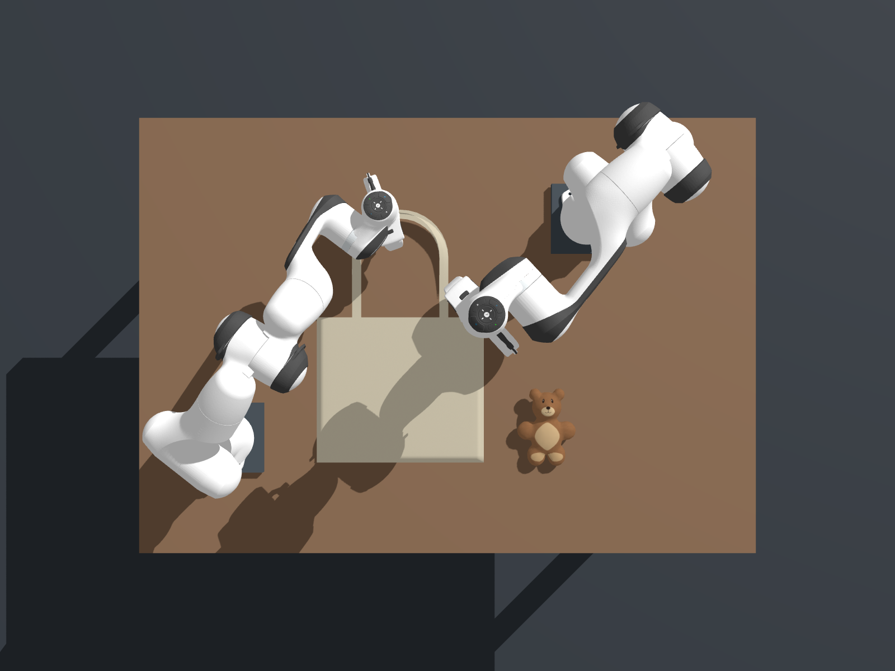

# 平放布袋：四个初始视角

这是修订场景 `flat_full_05` 在 **t=0** 的四张 Genesis 原生渲染，分辨率均为 1600×1200。袋身由两片布直接缝合并平放桌面，软体熊仰躺在旁边；双臂夹爪张开。四张图仅相机位置不同。

[下载四张原图及渲染记录](initial_images_4_views.zip)

| 视角 | 原图 |
| --- | --- |
| 斜视全景 | [initial_01_oblique.png](initial_01_oblique.png) |
| 正面近景 | [initial_02_front_close.png](initial_02_front_close.png) |
| 俯视 | [initial_03_top.png](initial_03_top.png) |
| 对侧正面 | [initial_04_opposite_front.png](initial_04_opposite_front.png) |

[原生渲染记录](initial_views.json)、[导出校验](export_provenance.json)与[直接视觉检查](visual_review.json)分别保留。导出没有推进物理、改变实体或编辑像素。

**验证范围：**此目录只证明平放初始场景与四个视角。单臂提袋、另一臂抓熊装入的完整修订流程仍在本机验证，尚未发布为成功运行；仓库原 full40 结果属于此前的直立袋流程。
